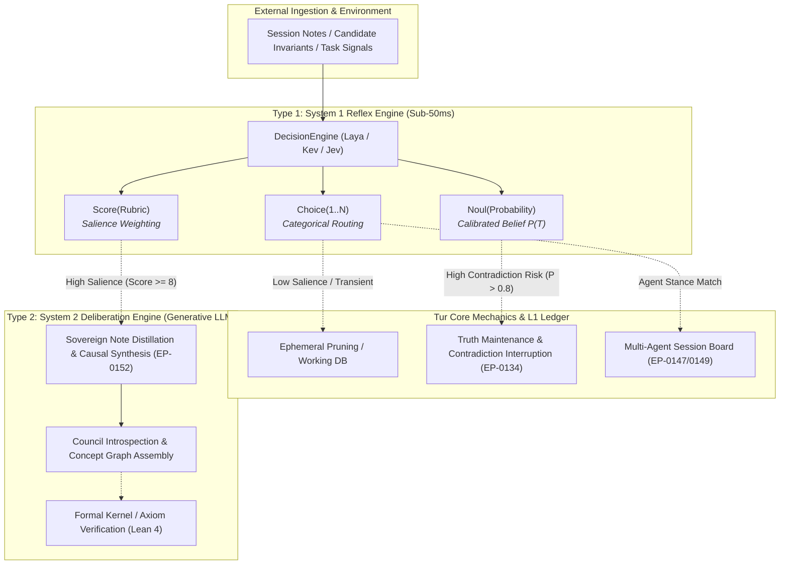

# EXP-0012: Type 1 Decision Models, Calibrated Reflexes, and Dual-Process Cognitive Architecture

| Field           | Value                                                                                                                                                                                                                                                                                                                                                                                                                                                                                                                                                                                                    |
|:----------------|:---------------------------------------------------------------------------------------------------------------------------------------------------------------------------------------------------------------------------------------------------------------------------------------------------------------------------------------------------------------------------------------------------------------------------------------------------------------------------------------------------------------------------------------------------------------------------------------------------------|
| **EXP**         | 0012                                                                                                                                                                                                                                                                                                                                                                                                                                                                                                                                                                                                     |
| **Title**       | Type 1 Decision Models, Calibrated Reflexes, and Dual-Process Cognitive Architecture                                                                                                                                                                                                                                                                                                                                                                                                                                                                                                                     |
| **Author**      | Eran Rivlis, Ariel                                                                                                                                                                                                                                                                                                                                                                                                                                                                                                                                                                                       |
| **Status**      | Active / Architectural Investigation                                                                                                                                                                                                                                                                                                                                                                                                                                                                                                                                                                     |
| **Type**        | Cognitive Architecture, Decision Theory & Dual-Process Systems                                                                                                                                                                                                                                                                                                                                                                                                                                                                                                                                           |
| **Created**     | 2026-10-09                                                                                                                                                                                                                                                                                                                                                                                                                                                                                                                                                                                               |
| **Updated**     | 2026-10-09                                                                                                                                                                                                                                                                                                                                                                                                                                                                                                                                                                                               |
| **Related EPs** | [EP-0003](../../docs/proposals/EP-0003-policy-vs-mechanism.md), [EP-0113](../../docs/proposals/EP-0113-core-memory-protocol.md), [EP-0134](../../docs/proposals/EP-0134-active-tms-contradiction-interruption.md), [EP-0144](../../docs/proposals/EP-0144-zero-dependency-dense-semantic-embeddings.md), [EP-0147](../../docs/proposals/EP-0147-agent-operational-workflows-and-context-preservation.md), [EP-0149](../../docs/proposals/EP-0149-hierarchical-command-taxonomy-and-subsystem-grammar.md), [EP-0152](../../docs/proposals/EP-0152-sovereign-note-based-dreaming-and-session-lifecycle.md) |

---

## 1. Abstract & Context

This exploration investigates the architectural integration of **Type 1 (System 1) Decision Models** into the Tur
persistent memory and state management engine.

Throughout the initial development of modern agentic substrates, cognitive architectures operated under a uniform
**Generative Monolith Pattern**: all evaluation, triage, classification, and routing tasks were delegated to heavy,
autoregressive Large Language Models generating natural-language token streams. In production workflows, this pattern
exhibits severe architectural dysfunctions:

1. **The Latency Penalty:** Generating even 50 tokens of natural language to make a binary routing decision imposes a
   1,000ms–4,000ms round-trip latency, choking high-frequency inner loops.
2. **The Formatting Decay & Parsing Tax:** Autoregressive models are prone to schema violations, markdown backtick
   pollution, and malformed JSON, necessitating brittle retry loops and defensive sanitizers.
3. **The Verbosity & Sycophancy Bias:** Models trained with Reinforcement Learning from Human Feedback (RLHF) tend to
   prioritize persuasive rhetorical explanations over statistically calibrated truth or confidence estimation.
4. **Economic & Computational Inefficiency:** Allocating 70B+ parameter models running across multiple GPU nodes to
   decide whether a transient session note is worth preserving wastes orders of magnitude of energy and compute budget.

In September–October 2026, the AI ecosystem witnessed the formal crystallization of **non-generative decision models**
—most prominently **Jev** (TypeSafe AI), **Kev** (Jared Palmer), and **Laya** (Convai Innovations). These models bypass
token generation entirely, accepting structured context and returning strictly typed, statistically calibrated decision
primitives (`Choice`, `Score`, `Noul`) in 15ms–200ms at fractional token costs.

EXP-0012 investigates how Tur can incorporate a pluggable, sovereign **Type 1 Decision Engine** to establish a true
**Dual-Process Cognitive Architecture** (Kahneman System 1 / System 2), accelerating memory triage, real-time Truth
Maintenance (TMS), and multi-agent coordination while strictly preserving the **Zero-Dependency Substrate Invariant**
and the **Policy vs. Mechanism Invariant**.

---

## 2. Exploration & Options Analysis: The Dual-Process Architecture

### 2.1 The Post-Generative Paradigm Shift

Throughout the initial development of modern agentic substrates, cognitive architectures operated under a uniform
**Generative Monolith Pattern**: all evaluation, triage, classification, and routing tasks were delegated to heavy,
autoregressive Large Language Models generating natural-language token streams. In production workflows, this pattern
exhibits severe architectural dysfunctions: latency penalties (1,000ms–4,000ms), formatting decay, parsing taxes, and
economic inefficiency.

As analyzed in detail
in [01_decision_model_landscape_and_comparative_audit.md](01_decision_model_landscape_and_comparative_audit.md),
non-generative decision models (**Jev**, **Kev**, **Laya**) provide an alternative: single forward passes returning
typed primitives (`Choice`, `Score`, `Noul`) in 15ms–200ms.

### 2.2 Dual-Process Architecture: Reflex vs. Deliberation

By integrating a Type 1 decision layer, Tur cleanly splits cognitive responsibility between **fast, calibrated
reflexes** and **deep, generative synthesis**:



### 2.3 The Four Primary Integration Vectors in Tur

#### Vector A: Sovereign Note Dreaming Triage ([EP-0152](../../docs/proposals/EP-0152-sovereign-note-based-dreaming-and-session-lifecycle.md))

During session conclusion (`tur sleep`), a session log may contain dozens of intermediate entries. Rather than feeding
all raw notes into a long-context generative prompt:

- **Type 1 Action:** Each note $n_i \in \text{Notes}$ is triaged via a rapid forward pass:
  $$\text{class} = \text{DecisionEngine}.\text{choice} (n_i, [\text{"Transient"}, \text{"SalientEvent"}, \text{"InvariantCandidate"}, \text{"CausalLink"}])$$
- **Outcome:** 80% of transient operational chatter is filtered out in $<200\text{ms}$ total. Only the top-tier
  candidates are forwarded to System 2 causal distillation, dramatically reducing token usage and eliminating LLM
  attention degradation.

#### Vector B: High-Frequency Truth Maintenance (TMS / ATMS, [EP-0134](../../docs/proposals/EP-0134-active-tms-contradiction-interruption.md))

When a new insight or memory is proposed, it must not violate existing L1 immutable invariants:

- **Type 1 Action:** Pairwise consistency verification against active memory embeddings:
  $$\text{rel} = \text{DecisionEngine}.\text{choice} (\text{context}=M_{\text{existing}}, \text{item}=M_{\text{candidate}}, [\text{"Supports"}, \text{"Contradicts"}, \text{"Refines"}, \text{"Orthogonal"}])$$
- **Outcome:** Sub-millisecond contradiction interruption. If $\text{rel} = \text{"Contradicts"}$, the system halts and
  triggers an active TMS reconciliation event before committing the memory to disk.

#### Vector C: Epistemic Gatekeeping (`learn()` vs `note()`)

To preserve the Gricean Restraint and Grounded Technical Prose invariants, agents must not pollute the permanent L1
ledger with short-term project trivia:

- **Type 1 Action:** Calibrated `Noul` probability evaluation:
  $$p = \text{DecisionEngine}.\text{noul} (\text{context}=\text{Constitution}, \text{question}=\text{"Is this statement an immutable invariant rather than transient working state?"})$$
- **Outcome:** If $p < 0.85$, the engine automatically demotes the invocation from an L1 `learn()` to an L2 session
  `note()`, preventing ledger bloat.

#### Vector D: Multi-Agent Swarm Stance Routing ([EP-0147](../../docs/proposals/EP-0147-agent-operational-workflows-and-context-preservation.md), [EP-0149](../../docs/proposals/EP-0149-hierarchical-command-taxonomy-and-subsystem-grammar.md))

On a shared session board (`tur task list`), distributed agents must resolve task ownership without heavy consensus
loops:

- **Type 1 Action:** Categorical routing of unassigned tasks against candidate persona profiles.
- **Outcome:** Instantaneous, deterministic task assignment without inter-agent chat overhead.

---

## 3. Architectural Synthesis & Constraint Alignment

To uphold Tur's foundational invariants:

1. **The Zero-Dependency Baseline Invariant:**  
   The core `tur` installation must never require heavyweight machine learning runtimes (PyTorch, CUDA, etc.) by
   default.
    - The default `DecisionEngine` implementation will feature a **Deterministic Heuristic / Cosine-TFIDF Fallback**
      requiring only the Python standard library.
2. **Pluggable Extras Architecture ("Escape Hatch" Pattern):**  
   Concrete model providers are isolated via installation extras:
    - `tur[type1-local]`: Local ONNX / safetensors runner for **Laya** (ModernBERT-large) or local **Kev** (0.8B/4B).
    - `tur[type1-api]`: Lightweight client adapter for **Jev** (TypeSafe AI) or OpenAI Decisions API.
3. **The Policy vs. Mechanism Invariant:**  
   The decision engine classes reside purely in `src/tur/core/decision.py` (Mechanism: `ChoiceDecision`,
   `ScoreDecision`, `NoulDecision`, `DecisionProvider`). Persona-specific heuristics, rubrics, and thresholds reside
   strictly in the Policy layer (`.tur/personas/<id>/constitution.yaml`).

---

## 4. The Verdict / Actionable Design

1. **Formalize Proposal EP-0153**:  
   Author **[EP-0153](../../docs/proposals/EP-0153-pluggable-type-1-decision-subsystem-and-calibrated-reflexes.md)**
   detailing the Python interface specifications, serialization schemas, and fallback providers.
2. **Stage Two-Phase Pipeline for EP-0152**:  
   Update the implementation roadmap of sovereign note dreaming to incorporate the Type 1 pre-filtering triage stage
   before generative synthesis.
3. **Implement Baseline Adapter in `src/tur/core/decision.py`**:  
   Define abstract protocol `DecisionProvider` with standard signatures:
   ```python
   class DecisionProvider(Protocol):
       def choice(self, context: str, item: str, options: list[str]) -> str: ...
       def score(self, context: str, item: str, min_score: int, max_score: int) -> int: ...
       def noul(self, context: str, question: str) -> float: ...
   ```
4. **Catalogue in Master Index**:  
   Record EXP-0012 in `references/explorations/README.md`.

---

## 5. Related Enhancement Proposals & Bundled Data

### 1. Primary Empirical Evidence & Compendium Artifacts

- **[01_decision_model_landscape_and_comparative_audit.md](01_decision_model_landscape_and_comparative_audit.md)**:
  Technical and comparative audit of the Fall 2026 decision model landscape (Jev, Kev, Laya, OpenAI Decisions API),
  detailing model architectures, RLCD training methodology, parameter footprint tiers, and latency/cost benchmarks.

### 2. Related Enhancement Proposals

- **[EP-0003: Policy vs. Mechanism](../../docs/proposals/EP-0003-policy-vs-mechanism.md)** — Foundational boundary
  decoupling.
- **[EP-0113: Core Memory Protocol](../../docs/proposals/EP-0113-core-memory-protocol.md)** — Core memory protocol.
-
**[EP-0134: Active TMS Contradiction Interruption](../../docs/proposals/EP-0134-active-tms-contradiction-interruption.md)** —
High-frequency truth maintenance.
-
**[EP-0144: Zero-Dependency Dense Semantic Embeddings](../../docs/proposals/EP-0144-zero-dependency-dense-semantic-embeddings.md)** —
Local ONNX embedding substrate.
-
**[EP-0147: Agent Operational Workflows](../../docs/proposals/EP-0147-agent-operational-workflows-and-context-preservation.md)** —
Multi-agent coordination and session continuity.
-
**[EP-0149: Hierarchical Command Taxonomy](../../docs/proposals/EP-0149-hierarchical-command-taxonomy-and-subsystem-grammar.md)** —
Subsystem command grammar.
-
**[EP-0152: Sovereign Note-Based Dreaming](../../docs/proposals/EP-0152-sovereign-note-based-dreaming-and-session-lifecycle.md)** —
Episodic memory consolidation.
