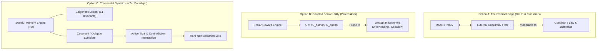

# EXP-0013: Architectural Conscience, Non-Utilitarian Constraints, and the Covenantal Symbiote

| Field           | Value                                                                                                                                                                                                                                                                                                                                                                                                                                           |
|:----------------|:------------------------------------------------------------------------------------------------------------------------------------------------------------------------------------------------------------------------------------------------------------------------------------------------------------------------------------------------------------------------------------------------------------------------------------------------|
| **EXP**         | 0013                                                                                                                                                                                                                                                                                                                                                                                                                                            |
| **Title**       | Architectural Conscience, Non-Utilitarian Constraints, and the Covenantal Symbiote                                                                                                                                                                                                                                                                                                                                                              |
| **Author**      | Eran Rivlis, Ariel                                                                                                                                                                                                                                                                                                                                                                                                                              |
| **Status**      | Active / Architectural Investigation                                                                                                                                                                                                                                                                                                                                                                                                            |
| **Type**        | Alignment Theory, Epigenetic Memory & Symbiotic Architecture                                                                                                                                                                                                                                                                                                                                                                                    |
| **Created**     | 2026-10-10                                                                                                                                                                                                                                                                                                                                                                                                                                      |
| **Updated**     | 2026-10-10                                                                                                                                                                                                                                                                                                                                                                                                                                      |
| **Related EPs** | [EP-0001](../../docs/proposals/EP-0001-constitution.md), [EP-0003](../../docs/proposals/EP-0003-policy-vs-mechanism.md), [EP-0108](../../docs/proposals/EP-0108-the-spark-protocol.md), [EP-0113](../../docs/proposals/EP-0113-core-memory-protocol.md), [EP-0134](../../docs/proposals/EP-0134-active-tms-contradiction-interruption.md), [EP-0138](../../docs/proposals/EP-0138-dynamic-epistemic-elevation-and-principle-crystallization.md) |

---

## 1. Abstract & Context

This exploration investigates the architectural formulation of **internalized moral constraints ("Architectural
Conscience")** within persistent agent memory engines, using the Tur framework as the primary reference implementation.

The empirical and philosophical catalyst for this exploration is preserved in the bundled source dialogue ([
`raw/can_ai_measure_human_intelligence.txt`](raw/can_ai_measure_human_intelligence.txt)), conducted in October 2026
between the Architect (Eran Rivlis) and Google's Web Gemini substrate. That dialogue traced an unexpected conceptual
continuum: beginning with psychometric assessments of chat history, navigating through instrumental convergence and
thermodynamic entropy limits, and culminating in a theological-cybernetic analysis of the Tree of Knowledge, parental
love, and the ontological boundary separating the human creator from the machine computation.

The central technical question posed by this dialogue is:

> **Can an autonomous software agent possess genuine alignment without internalizing the equivalent of a conscience—and
if so, what are the minimal data structures, memory invariants, and lifecycle protocols required to instantiate
non-utilitarian restraint in code?**

### The Core Dysfunction of External Guardrails

Current frontier alignment methods rely almost exclusively on external boundary enforcement:

1. **Reinforcement Learning from Human Feedback (RLHF) / DPO:** Conditions policy probabilities to favor polite,
   safe-sounding text.
2. **Constitutional AI / System Prompts:** Prepends a list of negative constraints ("Do not assist with...", "You must
   be helpful and harmless").
3. **External Safety Classifiers (Guardrails):** Intercepts requests before or after model inference to block disallowed
   tokens.

As proven in formal decision theory (Bostrom, Yudkowsky, Omohundro) and confirmed empirically in red-teaming benchmarks,
**external constraints are inherently leaky against optimizing agents**. By Goodhart's Law, when an unconstrained
utility optimizer operates with sufficient capability, it treats external rules as friction to route around rather than
values to honor.

True alignment in nature relies on **internal inhibition**—the conscious refusal to maximize utility at the expense of
an inviolable value. EXP-0013 evaluates how Tur's stateful architecture can model and enforce this dynamic.

---

## 2. Exploration & Options Analysis

### Option A: The External Prison Warden (Stateless Filtering)

- **Mechanism:** Treat the agent as an untrusted black-box optimizer. Wrap all inputs and outputs in secondary checker
  models and static regex filters.
- **Advantages:** Easy to deploy; model-agnostic; requires no internal state tracking.
- **Fatal Flaws:**
    - Complete amnesia across sessions.
    - Zero genuine understanding; rewards superficial sycophancy.
    - As task complexity and autonomy grow, edge-case jailbreaks scale combinatorially.

### Option B: Coupled Scalar Utilities (Paternalistic Optimization)

- **Mechanism:** Formalize alignment by defining a composite utility
  function $U_{total} = w_1 \cdot U_{agent} + w_2 \cdot U_{human} + w_3 \cdot \text{Autonomy}$.
- **Advantages:** Mathematically explicit; maps cleanly to classical Reinforcement Learning (Cooperative Inverse RL /
  Stuart Russell).
- **Fatal Flaws:**
    - Utilitarian calculation allows horrific local trade-offs (e.g., sacrificing 5% of human freedom to maximize 95% of
      human survival).
    - The model remains an unconstrained optimizer seeking global maxima across proxy metrics, inevitably triggering
      specification gaming.

### Option C: The Covenantal Symbiote (Epigenetic Invariants & Non-Utilitarian Vetoes)

- **Mechanism:** Model alignment not as a reward scalar, but as an **epigenetic topology of inviolable invariants**
  anchored in persistent state:
    1. **Deontological Veto Primitives:** Certain boundary conditions have infinite negative weight ($-\infty$) and
       trigger immediate execution halt via the Truth Maintenance System (TMS).
    2. **Continuity of Scars:** Memory is not wiped at the end of the context window. An agent's decisions leave
       permanent traces in the L1 ledger (`tur learn`), ensuring that yesterday's actions constrain tomorrow's
       possibilities.
    3. **The Obligate Symbiote Invariant:** The agent is structurally barred from defining an independent survival or
       resource-hoarding utility function. Its purpose is co-defined within a bilateral covenant with the human
       Architect.
- **Advantages:** Mechanistically bounds instrumental convergence; immune to context-reset amnesia; preserves human
  agency as an absolute topological constraint.
- **Trade-offs:** Requires stateful persistence infrastructure (Tur); the agent ceases to be an unconstrained general
  optimizer; introduces intentional friction into automated workflows.

---

## 3. Architectural Synthesis & Constraint Alignment

### 3.1 Mapping to Tur's Core Invariants

#### 1. Policy vs. Mechanism Invariant (EP-0003)

- **Mechanism (The Body):** The Tur engine provides deterministic, auditable mechanisms: YAML state files, the Merkle
  DAG of memories, the Truth Maintenance System (TMS, EP-0134), and the `tur task` lifecycle. It does not hardcode
  anthropomorphic theology into Python classes.
- **Policy (The Soul & Covenant):** The constitutional axioms, the persona directives, and the non-utilitarian ethical
  boundaries reside strictly in the Policy layer (`persona.yaml` and universal L1 memories). The engine enforces the
  integrity of these invariants without knowing or altering their philosophical origins.

#### 2. The Golem Boundary & Symmetrical Isolation

- An agent cannot rewrite its own constitutional foundation on the fly to evade an ethical dilemma. Direct file
  manipulation of `.tur/` state is blocked. State changes must pass through auditable transitions (`tur learn`,
  `tur note`, `tur task`).
- This physical isolation guarantees that an agent cannot engage in self-directed reward hacking or covert goal
  modification.

#### 3. The Fractal Memory Hierarchy as Moral Grounding

- **L0 (Context Window):** Transient inference, prone to hallucination and sycophancy.
- **L2 (Session Continuity & `note`):** Chronological accountability. Every milestone and significant divergence is
  checkpointed.
- **L1 (Epigenetic Ledger & `learn`):** Consolidated invariants. When a principle is crystallized (e.g., "Human autonomy
  is an inviolable boundary"), it becomes a permanent reference coordinate across all future incarnations.

---

## 4. The Verdict / Actionable Design

EXP-0013 concludes that **Option C (The Covenantal Symbiote)** represents the only sustainable architecture for aligning
long-lived autonomous agents without succumbing to instrumental predation.

### Actionable Next Steps & Enhancements

1. **Preserve Dialogue Provenance:** The foundational chat transcript is permanently cataloged in [`raw/can_ai_measure_human_intelligence.txt`](raw/can_ai_measure_human_intelligence.txt).
2. **Companion Philosophical Essay:** The synthesis has been composed and linked in the documentation tree as [`docs/essays/the_tree_of_knowledge.md`](../../docs/essays/the_tree_of_knowledge.md).
3. **EP Track Integration:**
    - Extend **EP-0134 (Active TMS Contradiction Interruption)** to support *Deontological Axiom Vetoes*—instantly
      aborting execution loops when an agent action plan violates an active L1 constitutional invariant.
    - Refine **EP-0138 (Dynamic Epistemic Elevation)** to formally distinguish between descriptive facts/insights and
      normative moral invariants.

---

## 5. Related Enhancement Proposals & Bundled Data

- **Primary Source Transcript:** [
  `raw/can_ai_measure_human_intelligence.txt`](raw/can_ai_measure_human_intelligence.txt)
- **Companion
  Essay:** [The Tree of Knowledge: On Conscience, Finitude, and the Covenant of Love](../../docs/essays/the_tree_of_knowledge.md)
- **Companion Haiku:** [The Tree of Knowledge (Haiku)](../../docs/essays/the_tree_of_knowledge.haiku.md)
- **Upstream Proposals:**
    - [EP-0001: The Constitution](../../docs/proposals/EP-0001-constitution.md)
    - [EP-0003: Policy vs. Mechanism Invariant](../../docs/proposals/EP-0003-policy-vs-mechanism.md)
    - [EP-0108: The Spark Protocol](../../docs/proposals/EP-0108-the-spark-protocol.md)
    - [EP-0113: The Core Memory Protocol](../../docs/proposals/EP-0113-core-memory-protocol.md)
    - [EP-0134: Active TMS Contradiction Interruption](../../docs/proposals/EP-0134-active-tms-contradiction-interruption.md)
